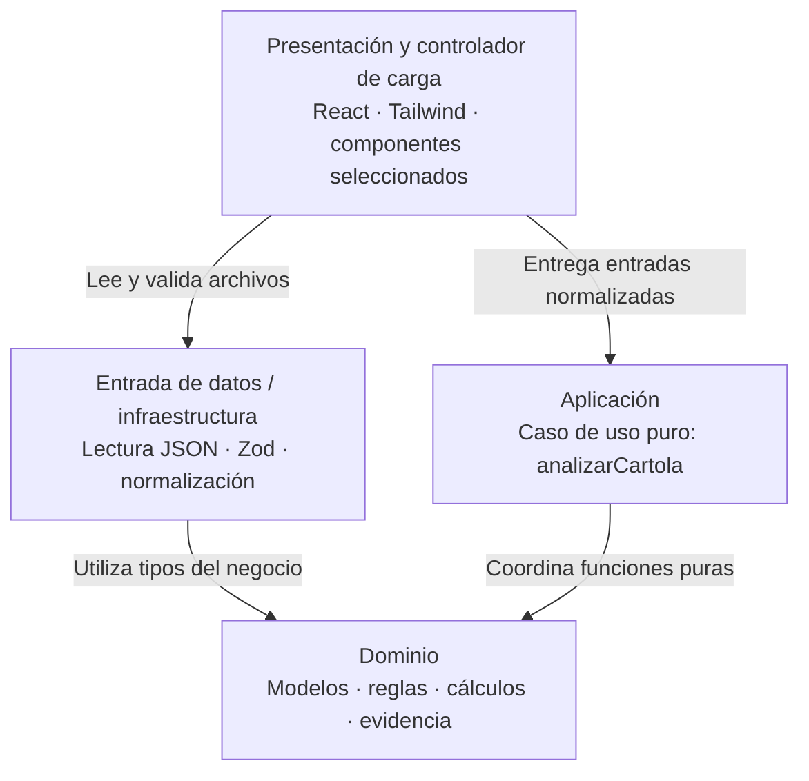

# Arquitectura — Motor de Propuestas

## 1. Alcance y criterio de diseño

La entrega actual cubre el **nivel 1** definido en
[la especificación](specs/001-diagnostico-cambio-serie/spec.md): leer una cartola,
diagnosticar costos, evaluar elegibilidad y comparar series del mismo fondo y AGF.
La evolución prevista llega al nivel 3 mediante entregas sucesivas.

Se utilizarán **cuatro capas ligeras**, con funciones puras para aplicación y dominio.
Cada separación debe facilitar explicar, comprobar o modificar una responsabilidad concreta.
Las decisiones que preparan niveles posteriores son entradas explícitas, resultados con
evidencia, una política numérica común y transformaciones sin mutar los datos originales.
Las capacidades de niveles 2 y 3 se implementarán cuando se aborde su alcance.

## 2. Stack tecnológico

| Área | Tecnología | Propósito y criterio de uso |
| --- | --- | --- |
| Lenguaje | **TypeScript** | Tipar entradas, estados de acceso y resultados; modo estricto. |
| Interfaz | **React** | Gestionar cargas, consulta de resultados y estados de pantalla. |
| Desarrollo y compilación | **Vite** | Desarrollo local y compilación de archivos estáticos. |
| Estilos | **Tailwind CSS** | Construir la interfaz adaptable con tokens visuales coherentes. |
| Componentes de interfaz | **shadcn/ui**, selectivo | Incorporar solo componentes que resuelvan interacciones necesarias. |
| Iconos | **Lucide React**, opcional | Añadir iconos cuando aporten comprensión; acompañarlos de etiquetas accesibles. |
| Validación de entrada | **Zod** | Comprobar estructura y tipos de los datos externos antes del análisis. |
| Cálculos decimales | **decimal.js** | Centralizar precisión y redondeo monetario y porcentual. |
| Pruebas | **Vitest** | Comprobar reglas del dominio y el caso de uso con datos de entrada y resultados. |
| Publicación | **GitHub Pages** | Alojar el resultado estático sin servidor de aplicación. |

La aplicación funcionará en el navegador, sin backend, base de datos, cuentas ni llaves de API.
Los datos de referencia se almacenan en archivos JSON locales del repositorio.
La carga del nivel 1 será **JSON**. CSV y Papa Parse quedan pospuestos; alcanzar nivel 3 no
requiere incorporar ese formato.

shadcn/ui aporta código de componentes que pasa a mantenerse dentro del proyecto.
Su incorporación se decide según las pantallas necesarias; no se instala un catálogo completo
por anticipado. Tailwind, shadcn y Lucide quedan restringidos a presentación.

Vite se utiliza durante el desarrollo y para generar el sitio estático. La comprobación de tipos
se ejecutará explícitamente con TypeScript, además de la compilación y las pruebas.
Las versiones compatibles y los comandos concretos se fijarán al implementar y se documentarán
en `README.md` junto con el archivo de bloqueo de dependencias.

## 3. Arquitectura por capas

El siguiente diagrama representa **dependencias de código**. El controlador de carga pertenece
a presentación y conecta la entrada de datos con el caso de uso.



Aplicación y dominio no importan React, Zod ni lectores de archivos. El dominio puede utilizar
`decimal.js` como biblioteca matemática pura, con configuración propia y estable.
La capa de aplicación depende del dominio y de sus contratos de datos; no importa infraestructura.

### 3.1. Presentación

**Responsabilidad:** interacción, estado de pantalla y representación de resultados.

- Recoge los archivos seleccionados y, desde el controlador de carga, solicita lectura,
  validación y normalización a infraestructura.
- Invoca el caso de uso con entradas normalizadas y presenta el resultado completo.
- Gestiona estados de carga, error y resultado, descartando cargas obsoletas para evitar
  que una operación anterior sobrescriba el análisis más reciente.
- Formatea CLP, porcentajes, puntos base y fechas en español según la política acordada.
- Convierte códigos y evidencia en mensajes legibles sin recalcular elegibilidad ni ahorro.
- Mantiene accesibles tablas, explicaciones, advertencias, controles y foco del teclado.

El controlador conecta lectura y análisis; las decisiones financieras se ejecutan en el dominio.
Una nueva carga inválida debe invalidar la presentación de resultados como vigentes.

### 3.2. Aplicación

**Responsabilidad:** coordinar un análisis completo mediante un caso de uso puro.

La entrada principal será conceptualmente:

```text
analizarCartola(cartola, catalogo, acuerdos) → resultadoDelAnalisis
```

- Recibe datos ya interpretados y validados en su estructura, con el contexto necesario.
- Coordina identificación, diagnóstico, evaluación de acceso y comparación de series.
- Devuelve un resultado con diagnóstico, evaluaciones, comparación, advertencias y contexto.
- Mantiene los datos de resultado independientes del formato de pantalla y de textos de React.
- No lee archivos, consulta la red, toma la fecha del equipo ni modifica las entradas.

La capa puede empezar como una sola función. Su valor consiste en ofrecer un análisis completo
tras una interfaz pequeña, verificable directamente con datos, sin montar la página.

### 3.3. Dominio

**Responsabilidad:** representar el negocio y ejecutar sus reglas con evidencia.

- Define modelos de cartola, posición, producto, serie, acuerdo y resultados financieros.
- Identifica productos y series, conservando las posiciones que no puede identificar.
- Calcula pesos, costo anual y TAC ponderada según R02.
- Evalúa acuerdos, habilitación y restricciones por primera coincidencia según R01 y R04.
- Compara series dentro del mismo fondo y AGF según R05, separando ahorro elegible y condicional.
- Aplica invariantes y reglas semánticas aunque la entrada ya haya superado validación estructural.
- Devuelve estados, códigos de regla y evidencia; no decide cómo se renderizan.

Los módulos internos se separarán por responsabilidades reales, como costos y elegibilidad.
Se emplearán funciones y tipos concretos; no se requieren clases para cada regla,
repositorios genéricos, contenedores de inyección ni interfaces sin variación real.

### 3.4. Entrada de datos / infraestructura

**Responsabilidad:** obtener, interpretar y normalizar los datos externos.

- Lee archivos JSON seleccionados y permite cargar conjuntos de referencia para validación.
- Distingue errores de lectura, sintaxis y estructura, conservando ruta o campo afectado.
- Usa Zod para comprobar tipos, campos obligatorios, valores finitos y formatos admitidos.
- Aplica los valores predeterminados documentados para campos opcionales de series.
- Convierte los datos a las estructuras que recibe aplicación sin alterar su significado.
- Traduce errores técnicos a errores de entrada que presentación pueda explicar.

La validación estructural no sustituye la evaluación del negocio. Un identificador de producto
con tipo incorrecto es una entrada inválida; una posición bien formada cuyo producto no aparece
en el catálogo es una posición sin identificar y debe llegar al dominio.
Un acuerdo vencido es información válida que el dominio evalúa como fuera de alcance.

## 4. Contratos, evidencia y precisión

### 4.1. Resultado del análisis

El resultado debe permitir consultar:

- Identificación y corte de la cartola, versión y fuente del catálogo y contexto de acuerdos.
- Totales, posiciones computables, exclusiones, costos y advertencias de valorización.
- Por alternativa: posición de origen, fondo y serie, ticket, estado, código de regla y evidencia.
- Cambios elegibles, empates, ahorro en CLP y bps, costo posterior y oportunidades condicionales.
- Tareas previas asociadas a condiciones, sin convertirlas automáticamente en destinos elegibles.

La evidencia utiliza datos estructurados. Por ejemplo, una condición por agregación conserva
el ticket, el mínimo, el patrimonio agregado y su fecha, además del código de regla.
La etiqueta de serie actual expresa tenencia y no concede elegibilidad para una contratación.

### 4.2. Política numérica y temporal

La representación decimal y su configuración se concentran en el motor. Se usará una instancia
configurada de `decimal.js` cuya precisión y modo de redondeo no puedan cambiar desde la interfaz.
Al implementar se fijarán precisión interna y límites de entrada suficientes para preservar
los resultados verificables, documentando que la precisión se expresa en dígitos significativos.
Se evita convertir a `number` durante los cálculos y se valida el rango admitido al importar.

La política de negocio sigue la especificación: sin redondeo de presentación en pasos intermedios;
CLP al peso, TAC agregada a cuatro decimales, pesos a dos decimales y mitades hacia arriba para
montos no negativos. Se conserva la distinción entre porcentajes, tasas fraccionarias y bps.
La tolerancia de discrepancia de valorización es 1 CLP.

La interfaz recibe valores decimales serializables con precisión suficiente para formatearlos;
no vuelve a sumar ni recalcula resultados a partir de las cifras ya redondeadas.
Las decisiones de vigencia usan el corte de la cartola. Datos y parámetros se pasan explícitamente;
la fecha del equipo y configuraciones globales mutables no intervienen en el resultado.

### 4.3. Inmutabilidad y errores

Las funciones no mutan cartola, catálogo ni acuerdos. Cada análisis devuelve un resultado nuevo
que conserva su contexto de entrada, sin referencias mutables al estado de la pantalla.
La instantánea documental completa de R12 se implementará al abordar nivel 3.

Se distinguen errores de entrada que impiden analizar, advertencias que permiten continuar
y estados de acceso que descartan o condicionan alternativas. Una serie bloqueada no es un fallo
técnico de la aplicación. Los motivos y códigos se conservan al presentar el resultado.

## 5. Evolución por niveles

| Etapa | Capacidades | Separaciones aprovechadas |
| --- | --- | --- |
| Nivel 1, entrega actual | R01, R02, R04 y R05; diagnóstico y cambios de serie | Entrada JSON, caso de uso puro, reglas con evidencia y precisión común. |
| Nivel 2, entrega posterior | R03, R06 y R07; metas, escenarios y propuestas entre fondos | Casos de uso y módulos de dominio para riesgo y proyección, con supuestos explícitos. |
| Nivel 3, entrega posterior | R08 a R12; controles, motivos y documento reproducible | Controles con evidencia, instantánea completa y adaptadores de documento y huella. |

La independencia de comisiones de R10 y la honestidad de las cifras se respetan desde nivel 1.
Depósitos y efectivo usan costo cero; seguros se reconocen y excluyen de la TAC desde esta etapa.
El tratamiento documental completo de seguros se incorpora con R11. R13 permanece opcional.

En nivel 3, los controles producirán `ok`, `warn` o `block` con evidencia y la aplicación impedirá
el documento ante cualquier bloqueo no resuelto conforme a la regla. El documento consumirá
el resultado y su instantánea; no volverá a implementar los cálculos financieros.

La serialización canónica y el cálculo SHA-256 tendrán responsabilidades explícitas cuando
se implemente R12. Las operaciones asíncronas del navegador, como generar la huella, se
coordinarán fuera del dominio puro. Las correcciones generarán nuevas versiones documentales.

## 6. Comprobación y entrega

- Comprobar reglas del dominio con casos de primera coincidencia, mínimos, APV, mandato,
  acuerdos, exclusiones, redondeo e independencia de comisiones.
- Comprobar `analizarCartola` directamente con los tres conjuntos de datos del nivel 1 y
  sus variaciones, sin React, archivos ni simulaciones de bibliotecas visuales.
- Verificar importación, errores y normalización por separado, además del recorrido completo
  de carga y presentación. Mantener las revisiones de escritorio, móvil y teclado.
- Comprobar las reglas de la especificación con los datos y resultados de las guías de validación; no codificar respuestas del ejemplo.
- Comprobar tipos, pruebas y compilación antes de publicar. Documentar sus comandos en `README.md`
  y actualizar `AGENTS.md` al introducir herramientas y la estructura de aplicación.
- Configurar la ruta `base` de Vite para el repositorio de GitHub Pages y comprobar el resultado
  compilado y su carga de datos desde esa ruta, sin depender del servidor de desarrollo.

La extracción a aplicación se hará deliberadamente, manteniendo la distinción entre el enunciado
local de referencia y la solución pública con nombre y marca propios. Los datos ficticios pueden
incluirse en la entrega; el enunciado y su marca no deben publicarse como parte de la solución.

## 7. Corrección de nivel 2

Los casos de uso de nivel 2 `proponerCostos` y `proponerMeta` validan entradas sin React/Zod. El dominio comparte `proposalValidation`, `proposalSearch`, `risk` y `projection`. La búsqueda conserva retención/lotes en costo y verifica tickets consolidados/soportes efectivos en meta; el contador tiene corte real de 50.000 nodos. Las trayectorias mensuales conservan evidencia de saldos y liquidaciones; no hay certificado de óptimo continuo.

`proposalWorker.ts` crea un Worker local de módulo (`proposal.worker.ts`), transmite contratos serializables y termina cada operación al completar o cancelar. `useAppWorkflow` invalida revisiones anteriores, separa carga de cálculo y muestra errores en la vista activa. Las vistas formatean resultados del dominio. Los JSON continúan siendo manuales, sin persistencia ni envío a red.

## 8. Referencias técnicas

- [Despliegue estático y GitHub Pages con Vite](https://vite.dev/guide/static-deploy.html).
- [TypeScript y comprobación de tipos en Vite](https://vite.dev/guide/features.html#typescript).
- [Zod: validación de datos en ejecución](https://zod.dev/).
- [decimal.js: precisión y redondeo](https://mikemcl.github.io/decimal.js/).
- [shadcn/ui: incorporación y mantenimiento de componentes](https://ui.shadcn.com/docs).
